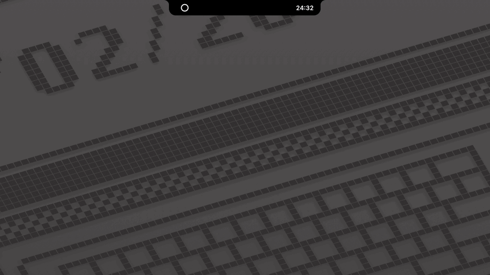
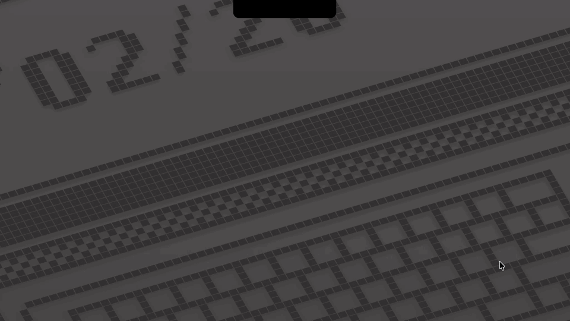
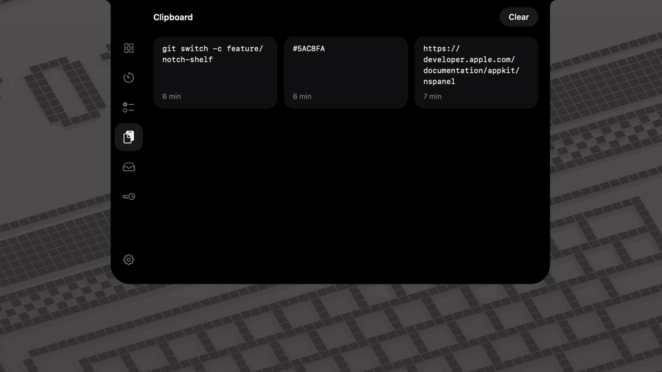
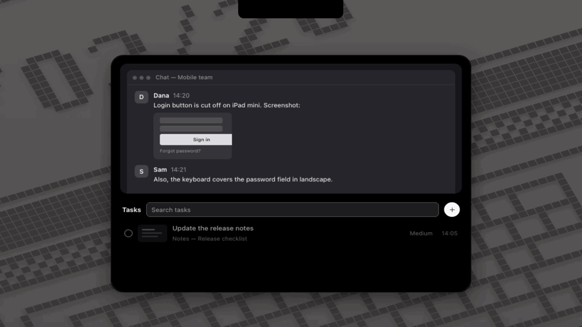

# Vortex

A macOS utility that lives in your MacBook's notch, or in the menu bar on a Mac without one. Hover over the notch and it opens with the tools you reach for a dozen times a day.



**Website:** [vortex-notch.web.app](https://vortex-notch.web.app), where you can try every feature in your browser. **Download:** [the latest release](https://github.com/OrtexIsArtem/vortex/releases/latest).

- **Timer**: set the minutes on a drum and watch the countdown in the notch. When time is up, it plays a sound, flashes and shows a notification.
- **Clipboard**: your last copies plus pinned ones: text, links, images and files.
- **Shelf**: put files aside and drag them out later, into any app. Unpinned files clear after a day.
- **Tasks**: press «+» in the Tasks tab, or a shortcut you set, to freeze the screen. Frame an area and press Return. You get a task with the screenshot, its recognized text and the page address from your browser.
- **Keys for Claude**: keep database URLs, API tokens and passwords in the macOS keychain. Claude Code runs commands with `{{key}}` placeholders through a local MCP server and never sees a value. Vortex asks you once per key per session.
- **Keyboard cleaning**: lock every key while you wipe the keyboard.

<table>
  <tr>
    <td width="50%"><b>Timer</b><br></td>
    <td width="50%"><b>Clipboard</b><br></td>
  </tr>
  <tr>
    <td><b>Shelf</b><br></td>
    <td><b>Tasks</b><br></td>
  </tr>
  <tr>
    <td><b>Keys for Claude</b><br></td>
    <td><b>Keyboard cleaning</b><br></td>
  </tr>
</table>

Vortex speaks English and Ukrainian, and follows light and dark mode.

## Privacy
- Vortex never goes online by itself: no analytics, no update checks. Network traffic comes only from commands that Claude runs through Keys, after you allow them.
- Its only listener is the MCP server for Claude Code. It listens on this Mac's loopback interface and needs a token.
- Your data stays in `~/Library/Application Support/Vortex`, and your secrets in your login keychain.
- Text recognition runs on your Mac.

## Permissions
On first launch, Vortex walks you through the permissions it can use. Every one of them is optional.

| Permission | Used for |
| --- | --- |
| Notifications | the timer's end, and Claude's key requests while the window is closed |
| Accessibility | keyboard cleaning |
| Screen Recording | tasks from the screen |
| Automation, per browser | a task's page address; macOS asks the first time |
| Paste from Other Apps | clipboard history, only on macOS versions that ask |

A feature whose permission is off shows a yellow warning. Click it to turn the permission on.

## Requirements
macOS 14 or later, on Apple silicon.

## Install

### In Terminal
```sh
curl -fsSL https://vortex-notch.web.app/install.sh | sh
```
The script downloads the latest release, checks that it is signed with Vortex's certificate, puts it in **Applications** and opens it. A download made by `curl` opens without the steps below. [Read the script](site/public/install.sh) first, if you like.

### Download a release
1. Download `Vortex-<version>.zip` from [Releases](https://github.com/OrtexIsArtem/vortex/releases/latest) and unzip it.
2. Open Vortex. macOS refuses to open it, because Vortex isn't notarized by Apple: that needs a paid developer account. Click **Done**, or **Cancel** on macOS 14.
3. Open **System Settings › Privacy & Security**, scroll to **Security**, and click **Open Anyway** next to the message about Vortex. Confirm with your password. On macOS 14 you can instead Control-click Vortex and choose **Open**.
4. Vortex offers to move itself to **Applications**, then shows its setup. To start it with your Mac, turn on **Open at login** there, or later in Settings.

### Update
- In Terminal, run the install command again.
- Or download the new release and open it with steps 2–3 above. Vortex offers to take the old one's place in **Applications**, and the old one goes to the Trash.

**Check for Updates** in Settings › General opens the latest release in your browser; Vortex itself never goes online.

Every release since 0.1.2 is signed with the same certificate, so macOS keeps Vortex's permissions across updates. Only the keychain asks again, as releases have no Team ID from Apple: click **Always Allow** for each key when macOS asks. A build of your own, signed with your team, avoids that too. See below.

Updating from 0.1.0 or 0.1.1, macOS asks one last time for **Screen Recording** and **Accessibility**: switch Vortex off and on in System Settings. Vortex opens Screen Recording's page by itself; Accessibility's opens from Home's keyboard button. Each browser asks once more too.

### Build it yourself
You need Xcode and [XcodeGen](https://github.com/yonaskolb/XcodeGen):
```sh
brew install xcodegen
git clone https://github.com/OrtexIsArtem/vortex.git
cd vortex
make install
```
`make install` builds a release, puts it in **Applications** and opens it. As is, the build is signed ad hoc, and macOS asks for the permissions again after each rebuild.

To keep the permissions across rebuilds, sign the build with your Apple team. A free Personal Team works:
1. Copy `Config/Local.xcconfig.example` to `Config/Local.xcconfig` and put your team ID in it. [CONTRIBUTING.md](CONTRIBUTING.md) shows how to find it.
2. Run `make open`, and build once in Xcode (⌘B). Xcode then creates your signing certificate.
3. Run `make install`.

For daily use, prefer `make install` over a Run in Xcode: a debug session ends when the Mac sleeps for a while, and the app with it.

## Claude Code
During setup, press **Connect** on the Claude Code page. Later, open **Keys**, press **Copy**, and run the command once in Terminal. Claude Code then lists your keys by name and can use them in commands.

## License
[MIT](LICENSE). Release downloads include the licenses of the open-source packages Vortex uses.
